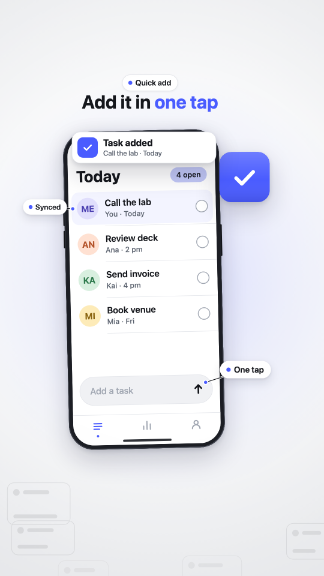

# UI mockup

The app demo film: a product shown **being used** inside device frames, the way launch videos do it. A calm studio ground (soft off-white, or graphite) with one large faint radial light and one soft brand-tinted glow behind the device. The stars are the devices, drawn in code: a phone (dark rounded shell, thin bezel, a rim light, a camera pill, a home indicator, side buttons, a layered drop shadow, a slight tilt) and a browser window (title bar with three grey dots, a rounded address field, a hairline, a shadow). Inside each is a clipped screen with its own coordinate system and scroll, holding an invented app built from clean parts: a large-title nav bar, list rows with initial avatars, cards, a segmented control, a bar or line chart, a text field with a caret where text is typed character by character, buttons, toggles, chips, a tab bar, skeleton loaders that resolve into content. Over the device: a touch dot or an arrow cursor that travels on eased arcs, hovers and clicks, and the UI answers on the click frame; notification banners that drop in on a spring; a round magnifier lens with a leader; small label chips pointing at features. System UI sans, neutral greys, white surfaces, hairlines, soft shadows, one accent.

Pick it for product and feature launches, app walkthroughs, onboarding, "how it works in three taps", changelog and release films, SaaS dashboards, anything where the plot is somebody using a screen. Not for stories without a screen in them, for characters and worlds, for a real product whose screenshots exist (use the screenshots: `drawAsset`), or for a look that should feel hand-made.

**The one rule: the device is being used. Every beat is a pointer action (a tap, a click, typing, a scroll) and the screen's answer to it on the same frame; nothing on a screen changes by itself.**

Everything is invented and unbranded: no real product names, logos, OS-trademark glyphs or recognisable real app layouts. The window dots are grey, the status row has no clock, the icons are the kit's own monoline set.

## Palette and meaning (`UI` in kit.js)

| colour | hex | use |
|---|---|---|
| ground | `#f4f5f7` | the studio (light); `STYLE.paper`, the sheet a morph happens on |
| ground, dark | `#17191e` | the graphite studio; white devices sit on it unchanged |
| light | `#ffffff` / `#2c303a` | the middle of the radial light on the light / dark ground (radius 0.6 H, centred at 0.4 H) |
| surface | `#ffffff` | screens, cards, banners, chips, the lens |
| fill | `#f0f1f4` | wells: an unfocused field, a segmented control's track, a neutral chip |
| fill 2 | `#e1e4ea` | an off toggle's track, skeleton bars (mixed 45% toward it) |
| line | `#e3e5ea` | 1.5 px hairlines: row separators, card and field edges, chart grid |
| ink | `#15171c` | primary text, the cursor, the chart's value pill |
| ink 2 | `#5f6672` | secondary text (subtitles, the address) |
| ink 3 | `#a2a8b3` | placeholders, inactive tab icons, chart labels, empty check rings |
| **accent** | `#4a5cff` | **the one brand colour**: the hero tile, the primary button, an on toggle, the focus ring, the caret, the highlighted bar, the active tab, selected chips, click ripples, the starred caption words. Override with `const UI_ACCENT = '#rrggbb'` before the kit |
| accent, soft | accent 26% on white (`#d0d5ff`) | the other bars of a chart; 10% accent is the wash on a row that was just added |
| device | `#1c1e24`, rim `#474b57`, pill `#0b0c0f` | the phone's shell, its rim light, the camera pill |
| chrome | `#eceef2`, dots `#cdd1d9` | the browser's title bar and its three dots |
| shadow | `rgb(18,22,38)` at 9–20% | three levels: 1 = (2 px down, 7 blur), 2 = (3, 9) + (14, 34), 3 = (6, 16) + (34, 84). Devices, banners and the lens use 3; floating chips 2; cards and knobs 1 |

- **Avatars** are the only other colours: five pale tints with a darker initial (`UI_TINTS`: peach, mint, lilac, butter, sky). They never carry meaning.
- The brand glow behind the device is the accent at 20% (light) or 34% (dark), radius about 700 px, drifting a few px.
- On the dark ground the caption is white and its starred words are the accent mixed 38% toward white.
- `STYLE.post` only darkens the corners by up to 7.5%. No grain, no blur, no translucency.

## Device and UI geometry

- **Logical units.** A screen is drawn in its own units whatever the device's size, tilt or the camera: a phone screen is `vw` = 280 units wide, a browser page 480. At the demo's sizes one unit is 1.75 px, which is what keeps the type readable: design in units, check the px.
- **Phone:** width = 0.49 × height; corner radius 0.16 × width (83 px at 1060 high); bezel 0.0132 × height (14 px); screen radius = corner − bezel; a 3 px rim-light stroke; the camera pill 66 × 21 units at the top; the home indicator 92 × 4.4 units, 10 units above the bottom; three side buttons. `v.top` = 42 units is reserved for the status row (signal bars left, a battery right, no clock). Resting tilt in the demo: −0.022 rad (about −1.3°).
- **Browser:** corner radius 24 px; title bar 72 px in `chrome` with three 8.5 px dots, a pill address field (60% of the bar's height, a lock glyph, the address in ink 2), a plus glyph, a hairline under it; a 1.5 px outer hairline at 10% ink.
- **Type** (system UI sans: `system-ui, -apple-system, "Segoe UI", Roboto, "Helvetica Neue", "Noto Sans", "Liberation Sans", Arial`), in the demo:

| text | units | px at 1080 × 1920 | weight |
|---|---|---|---|
| caption | – | 62 | 700 |
| tag above the caption | – | 26 | 600 |
| floating label chip, banner title | – | 26–31 | 600 / 700 |
| banner subtitle | – | 23–24 | 500 |
| phone: large title | 30 | 53 | 700 |
| phone: row title, field text | 17 | 30 | 600 / 500 |
| phone: row subtitle, count chip | 14 | 24.5 | 500 / 600 |
| browser: page title | 26 | 45.5 | 700 |
| browser: card title | 19 | 33 | 600 |
| browser: body, segmented labels | 16 | 28 | 500 / 600 |
| browser: big number | 60 | 105 | 700 |
| browser: chart labels and value pill | 14 | 24.5 | 500 / 700 |

  Nothing under 24 px. If a screen needs smaller type to fit, it has too much on it: cut parts, raise the unit (a smaller `vw`), or push the camera in.
- **Parts:** rows 62–68 units high with a 0.3 × height avatar and a hairline starting under the text; cards radius 16–22 units with a hairline and a level-1 shadow; fields and buttons are pills (radius = half height); the toggle is 0.6 × its width high with a white knob; chips are pills 2.05 × their type size high; the segmented control has a white thumb with a level-1 shadow; chart bars have 7-unit rounded tops and 40% gaps; skeleton bars are pills with a white band sweeping across all of them together.
- **Over the device:** the touch dot is 36 px in radius (ink at 26%, a 3.5 px white ring), the cursor an arrow 58 px high (ink, a white outline, a level-2 shadow); a click leaves an accent ring that grows to about 60–80 px and fades in 0.5 s. Banners are 100 px high with radius 27, an accent icon tile and two lines. The lens is a circle of about 108 px with a 9 px white ring; its source ring and leader are the accent on a white under-stroke. Label chips are white pills with an accent dot and a 2.2 px ink leader ending in an accent dot.

## Motion habits

- On 1s (`ones: true`), crisp. Three kinds of motion only:
  - **springs with a small overshoot** for things that arrive or switch: banners (`k 230, d 19`), rows opening, thumbs and toggles (`SPRING.snappy`), chips, the lens and caption words (`SPRING.smooth`), chart bars (`k 210, d 17`, each 0.03 s after its neighbour);
  - **ease in-out** for travel: the pointer's arcs, a page scroll, the camera;
  - **steady steps** for typing (12 characters a second, the caret solid while keys land and blinking at 2.2 Hz when idle) and counters (`uiCount`, ease-out).
- **The pointer leads.** It travels a curved leg (0.26–0.6 s by distance), arrives 0.12 s before the click (the hover), presses for 0.085 s (the cursor shrinks 12%, the touch dot 24%) and leaves a ripple. It never teleports and never clicks while moving.
- **The UI answers on the click frame.** `uiPress` is fully down on the cue's frame; `uiSpring` has already moved on it; a focus ring is already 60% on. Sounds land on the same frames.
- **One answer per click, then its consequence:** tap → focus; keys → characters; tap → the button sinks, a row opens and pushes the others down, the count chip flashes; a beat later the banner drops and the hero icon jumps. Click → the thumb slides, the bars re-grow, the number runs up. Click → the toggle flips, its label changes, the banner drops.
- **The device drifts in** (`o.in`): it rises about 110–130 px on a spring, scales from 0.93 and its tilt settles later than its rise (a softer spring), then floats 3 px.
- **The camera** pushes slowly (1.05–1.07) toward the part being used, anchored on the device's top edge so the device never slides under the caption, and pulls back before a bridge.
- **Idle life:** the caret, the skeleton shimmer, the icon's bob, the glow's drift, faint wireframe tiles rising behind the device (`uiDrift`).
- **Captions:** a small tag pill pops, then the words rise in 0.06 s apart; both fade in the first 0.2 s of a bridge and wait for the new window to open.
- **Bridges:** the old era is seen through a rounded tile with a shadow and closes onto the hero icon; on the bare ground the accent tile changes proportions while its check glyph fades; the new era opens out of an accent card of similar shape.

## Frame checklist (in addition to `grammar/FRAME.md`)

1. **Squint test: a device on a studio ground.** One device fills 45–80% of the frame's width, with its shadow, on a nearly empty ground. If it reads as a flat illustration or a slide of cards, the device frame or its shadow is missing.
2. **The screen is a believable app, not a wireframe:** a title, real (invented) words, avatars, at least three kinds of part, one clear primary action in the accent.
3. **Everything on the screen stays inside the screen:** rows, cards and text are clipped by the device; nothing spills past the bezel or the window edge. Only the pointer, banners, the lens and label chips cross a device's edge.
4. **Type is readable on a phone:** nothing under 24 px at 1080 wide, primary screen text 28 px or more; one line per label, no truncation.
5. **A pointer is in frame or has just left,** and something on screen is mid-answer to it (pressed, focused, sliding, growing, typing).
6. **The accent marks what matters now:** the hero tile, the action, the focused or changed thing. A frame with more than five accent areas has lost its focus; a frame with none has no subject.
7. **White surfaces, hairlines, soft shadows.** No outlines round shapes, no gradients except the ground's light and the hero tile's sheen, nothing frosted or translucent, no long or hard shadows.
8. **Floating things do not cover the text they are about:** the cursor's tip sits beside a label, the lens sits on an empty part of the page or off the device, a banner covers the status row or the title bar, not a title.
9. **The caption is one short line** at the top (baseline 362), 62 px, with one starred phrase in the accent and a tag pill above it; the device's top edge starts below it (y ≥ 430).
10. **Safe area:** type inside x 60–940, y 250–1500 after the camera's push; only a device's bottom edge or its shadow may dip below 1500.
11. **Bridge objects are rounded accent tiles of similar proportions** (the app icon → a card), clear of the pointer, banners and chips at the bridge time.

## Kit API (`kit.js`, on top of `kit/core.js`)

- Palette and constants: `UI { ground, groundD, light, lightD, surface, fill, fill2, line, ink, ink2, ink3, accent, body, bodyHi, bodyD, chrome, dots, shadow }`, `UI_SANS`, `UI_TINTS`, `UI_SH` (shadow levels), `UI_DARKMODE`. Piece options (plain constants before the kit): `UI_ACCENT`, `UI_DARK`.
- Colour and drawing basics: `uiA(c, alpha)`, `uiMix(a, b, u)`, `uiLum(c)`, `uiRGB(c)`, `uiZ()` (current zoom), `uiHair(px)` (a line that stays px wide on screen), `uiAlpha(a, fn)`, `uiRR(x, y, w, h, r)` / `uiPath(P)` / `uiCirc(x, y, r)` (paths), `uiShadow(path, level, { fill, k })`, `uiBox(x, y, w, h, r, fill, { shadow, line, lw })`.
- Type and icons: `uiText(str, x, y, size, colour, { weight, align, base, a })`, `uiTextW`, `uiFont`, `uiGlyph(name, x, y, s, colour, { w })` (`check`, `plus`, `up`, `chev`, `search`, `home`, `chart`, `bell`, `user`, `lock`, `list`, `clock`).
- Timing (closed-form in `TT`): `uiAt(t)`, `uiSpring(t0, SPRING.x)` (0 → 1, already moving on the cue frame), `uiPress(t0, hold, release)`, `uiTyped(str, t0, cps)` (characters shown), `uiCount(t0, d, a, b)`, `uiBlink(rate)`.
- The studio: `uiGround(colour, { glow: [x, y, r], glowA, lx, ly, lr })`, `uiDrift(key, n, { dark, speed, a })`.
- **Devices** (each returns its geometry `g`; `g.at(lx, ly)` turns a logical screen point into a world point, `g.pts()` is the device's outline, `g.s` the px per unit):
  - `uiPhone(x, y, h, o, drawScreen)` / `uiPhoneGeo(x, y, h, o)` — centre and height. `o`: `vw` (280), `tilt`, `in`, `tilt0`, `from`, `float`, `k`, `body`, `bg`, `status`, `statusC`, `bezel`, `ratio`, `scroll`.
  - `uiBrowser(x, y, w, h, o, drawScreen)` / `uiBrowserGeo(x, y, w, h, o)` — centre and size. `o`: `vw` (480), `bar` (72), `url`, `r`, `bg`, and the pose options.
  - `drawScreen(v, g)` draws in logical units, clipped to the screen: `v = { w, h, s, scroll, top, bottom }`.
  - `uiScroll(x, y, w, h, scroll, fn)` — a scrolling region: clipped, its content moved up by `scroll`. `uiCull(x, y, w, h, fn)` — text less than half inside the box is skipped (devices, `uiScroll` and the lens call it, so scrolled-out text is not drawn at all).
  - `uiPose(o)` — the drift-in / tilt-and-settle / float used by both.
- **UI parts** (in the current coordinates: units inside a screen, px when floating):
  - `uiNav(v, title, { chip, chipOn, size, y })`, `uiTabBar(v, glyphs, active, { h })`.
  - `uiRow(x, y, w, h, { initials, tint, title, sub, right: 'check' | 'chev' | text, on, k, hi, sep, size, pad })`, `uiAvatar(x, y, r, initials, { tint })`.
  - `uiCard(x, y, w, h, { r, fill, line, shadow, k, press, a }, draw)`.
  - `uiButton(x, y, w, h, label, { press, kind: 'primary' | 'soft' | 'plain', glyph, r, size })`.
  - `uiToggle(x, y, w, on)`, `uiSeg(x, y, w, h, items, pos, { size })`.
  - `uiField(x, y, w, h, { text, n, placeholder, focus, typing, size, r, pad })` → `{ caret, tw }`.
  - `uiChart(x, y, w, h, vals, { kind: 'bars' | 'line', grow, hi, value, labels, size, max, grid, gap, head, r, lw })` → points; `uiChartPts(...)` gives the same points without drawing (for the lens and the pointer).
  - `uiSkeleton(x, y, w, h, { r, sweep, speed })`, `uiSkelRow(x, y, w, h, { sweep, key })`, `uiResolve(k, skel, content)` (a skeleton that resolves into content as `k` goes 0..1).
  - `uiChip(str, x, y, { on, size, dot, glyph, k, shadow, fill, c, line, align })`.
- **Over the device:**
  - `uiCursor(keys, { s, out, travel, pause, bend })` and `uiTap(keys, { r, out, ... })` — the arrow and the touch dot. `keys = [[t, x, y, 'click'?], ...]` in world coordinates; both return `{ x, y, n, since, at, down }`. `uiPathAt(keys, t, o)` and `uiClicks(keys, t)` give position and click state without drawing; `uiRipple`, `uiArrowPts(x, y, s)`.
  - `uiToast(x, y, w, { t0, out, h, title, sub, glyph, drop, size })` — a banner dropping to its resting top-left corner.
  - `uiZoom(sx, sy, sr, dx, dy, dr, { k }, draw)` — a lens at (dx, dy) showing the region round (sx, sy) at `dr / sr` times; `draw` redraws the device (crisp, not a pixel copy).
  - `uiCallout(str, x, y, tx, ty, { k, size, glyph })` — a label chip with a leader to a feature.
- The hero: `uiAppIcon(x, y, s, { glyph, bob, kick, rot, c, k, shadow })` (sets `SPARK_AT`), `uiAppIconPts(x, y, s)`.
- Captions (through `DEFER`): `uiCaption('Add it in *one tap*', { y, size, at, dark, x })`, `uiTag('Quick add', { y, size, at, dark, x })`; `uiBridgeK()`, `uiArrive()`.
- `STYLE`: `paper` (the light ground), `backdrop` (the studio with its light, in any colour), `window` (the era through a tile with a shadow and a hairline), `blob` (the accent tile, its check fading as it changes), `hero` / `heroColor` / `heroPts` (the app icon), `post` (corner falloff), `ones: true`.

## Do / don't

- **Do** write the interaction as a cue list first (tap, type, tap, banner) and put every cue on a frame; put clicks on the beat grid and sounds on the same cues.
- **Do** compute pointer targets from the device (`g.at(lx, ly)`), so the pointer still lands when the device is tilted, floating or the layout changes.
- **Do** keep one device per era and let it be large; change the device, the ground (light / graphite) or the screen between eras.
- **Do** invent the app: plain nouns for titles ("Today", "This week"), short first names, an `.example` address.
- **Do** design the screen in units and simplify until the smallest type is 24 px or more.
- **Do** let banners, the lens and chips cross the device's edge: that depth is the look.
- **Do** keep the hero tile clear of everything at a bridge, and give the next era a card of similar proportions in the accent.
- **Don't** use a real product's name, logo, icon, layout or OS glyphs (coloured window dots, a brand's status bar, a recognisable keyboard).
- **Don't** change anything on a screen without a pointer action causing it (loading at the start is the one exception).
- **Don't** add a second accent, coloured cards or gradients; avatars are the only other colour.
- **Don't** make anything frosted, blurred or translucent (that is `glass`), and don't add facets, long shadows or a mascot (that is `flat-vector`).
- **Don't** put text under a banner, under the lens or under the cursor's arrow, and don't shrink type to fit more in.
- **Don't** call captions or the pointer inside the `draw` you give `uiZoom`: it runs twice.
- **Don't** redraw a real product from imagination when its screenshots exist.

## How it differs from the closest shipped styles

- **glass** is frosted translucent panels floating free over a moving aurora, with no device and nobody using them. Here every surface is opaque white, the ground is still and nearly empty, the parts live inside a device's clipped screen, and a pointer drives every change.
- **flat-vector** is illustration: flat facets, long shadows, bold icons, a capsule mascot, UI cards as props. Here the UI is the subject at product fidelity, shaded only by soft drop shadows, and the hero is the app's icon.
- **isometric** shows product line art in 2:1 projection; this is front-on, filled and typeset.
- **kinetic-type** shares the neutral ground and one accent, but its subject is words on a grid, not an interface.

## Not matched / known weaknesses

- Built from the genre's conventions (app launch and feature films), not measured from a reference; the devices are generic on purpose and no specific phone or browser was copied.
- No on-screen keyboard: text is typed straight into the field. A keyboard would have to be invented and would crowd a 280-unit screen.
- The magnifier is a redraw, so its `draw` runs twice per frame (about 35–45 ms a frame in the demo's second era) and must not have side effects. The lens is a circle only.
- Text culling is by line: a line less than half inside its viewport is skipped rather than clipped, so a title leaves a scrolling page a frame or two before its last pixels would.
- Shadows use the canvas's blur, so their softness can differ slightly between browser engines (the tools render in Chromium, where the demo tiles deterministic).
- The devices are flat, front-on rectangles with a small rotation: no perspective, no screen glare, no hand.
- Type is the platform's system sans, so glyph widths and the weight of 600 / 700 differ a little between macOS, Windows and Linux; layouts leave room for it but were checked on macOS only.
- Positions were tuned for 9:16 at 1080 × 1920; `uiCaption` and `uiTag` have a landscape default but other formats were not tested.
- Not exercised by the demo: the `line` chart, the `soft` button and buttons with labels, `uiRow`'s `chev` / text accessories and its `on` check, a banner's `out`, `uiCard`'s pop (`k`), a tilted or drifting browser, the device `scroll` option and `statusC`, `uiArrowPts`, most glyphs (`plus`, `search`, `home`, `clock`), `UI_ACCENT`, `UI_DARK`, and the hero-to-hero bridge (`STYLE.hero`). The demo does not loop seamlessly.

## Proven on

Its demo only. `demo/` (6s, 9:16, 120 BPM, 24fps), a feature launch for an invented to-do app. Era 1, a phone on the light ground: it drifts in and settles with a slight tilt, three rows resolve out of shimmering skeletons, a touch dot taps the field (the focus ring and caret come on), "Call the lab" is typed at twelve characters a second, a tap on the add button sinks it, opens a new row at the top that pushes the others down and turns "3 open" into "4 open", a "Task added" banner drops over the top of the phone, the app icon at the phone's shoulder jumps, and two label chips ("One tap", "Synced") point at the button and the new row while the camera pushes in and back. At 3.0 s the world closes onto the app-icon tile, which becomes the "Tasks done" card of era 2: the same app in a browser window on graphite, where a cursor clicks "Team" (the thumb slides, seven bars re-grow one after another, the peak moves and its value pill counts to 22, the big number runs from 24 to 96), the page scrolls up 60 units to bring "Most active" into view, a lens magnifies the peak, the cursor flips the "Weekly digest" toggle and a "Digest on" banner drops over the window's corner. Captions: "Add it in one tap", "Watch it add up". Score: a soft pluck pulse in D that opens to G, with a touch, twelve key ticks, a pop, two-note chimes for the banners, a mouse click, bars answering as plucks and a toggle blip on the cue frames. Tiles deterministic; the review's cut, morph, story-arc, text and dead-beat checks pass.
