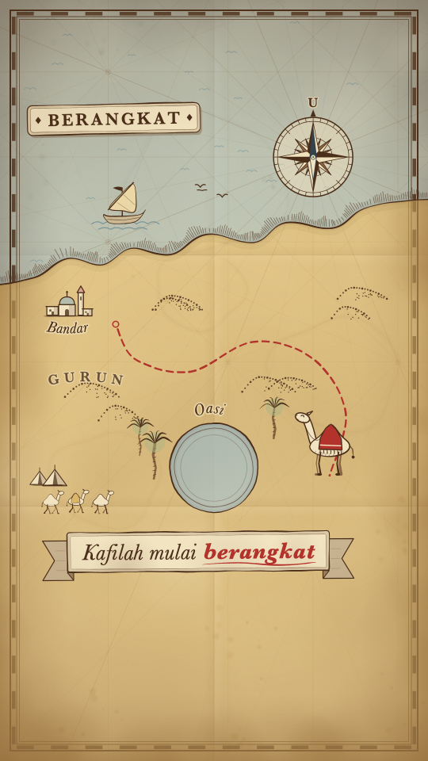

# Vintage map

An antique explorer's map, hand-drawn on aged parchment. The sheet is tea-stained, foxed, scorched at the edges and creased where it was folded; a faint web of rhumb lines radiates from a compass rose. Everything is drawn in sepia iron-gall ink with an uneven pen weight — every line is a ribbon that swells, thins and tapers — and tinted with thin watercolour washes that pool darker at their edges. Coasts carry stacked offshore hatching or fading contour lines; mountains are rows of shaded molehills, forests are clumps of tiny trees, deserts are dotted dunes, rivers taper to a hair at their source, towns are little domes and towers with italic names on curved baselines. One accent, madder red: a dashed route that travels across the sheet with the hero at its head. Motion on 2s: the ink boils, the quill draws.

Pick it for journeys, history, trade routes, hijrah and caravan stories, geography, "how X travelled from A to B", treasure-hunt framing, anything told as a path between places. Not for UI, data charts or close-up character acting (figures are small map signs).

**The one rule: it is a map, and the red route is the story.** Things are map signs seen from above or in tiny side view, placed on a sheet; nothing has perspective, sky or a horizon. Places are *inked on* when the route reaches them, never faded in from nowhere. Red is spent only on the journey.

## Palette and meaning (`VMP` in kit.js)

| role | hex | use |
|---|---|---|
| sheet | `paper #e6d2a5` | the parchment; the ground a morph happens on |
| light patch | `paperL #f2e4c1` | bodies of signs (buildings, sails, the camel), ribbons, tags, label halos |
| fold / scorch | `paperD #c8a86d`, `burn #6a4322` | ribbon tails; stains, foxing, burnt edges, the vignette (always at low alpha) |
| ink | `ink #4a2e1a` | every line, label and hatch (never black) |
| thinned ink | `inkL #8a6642`, `inkF #a98b62` | far legs, minor compass points, rhumb lines, palm trunks |
| land washes | `ochre #dbb568`, `sage #a9b584`, `rose #d9a08a` | desert, green country, towns and city ground |
| water | `sea #a8bdbd`, `seaD #6d8d94` | sea and lake wash; wave ink, rivers, sea labels |
| needle | `slate #33434d` | the compass needle only |
| **route / hero** | `madder #b3322b` | the dashed route, its X and flag, the hero's saddle cloth, and the one rubricated word of a caption |

A frame is parchment + one land wash + the sea + ink + red. Era changes swap the land wash (ochre → sage). Morph between washes (sea → rose); the blend reads as a mixed wash.

## Line, wash, texture, type

- **The pen** (`vmpInk`): a filled ribbon, not a stroke. Its width follows two seeded sine waves along its length (about 0.45–1.2 × the nominal weight), tapers to 30% over the first and last few widths, and its path wobbles ~1 px on every boil step. Weights: coast 3.8, objects 2.4–3, details 1.3–2, hatching 1.5 at 60% alpha.
- **Coast** (`vmpCoast`): the shore line plus offshore marks on the sea side — `hatch` (short strokes perpendicular to the shore whose length rises and falls in a rhythm), `lines` (2–3 contour lines stepping away and fading), or `both`. `frac` draws it on; `pen: true` shows the quill at the tip.
- **Wash** (`vmpWash`): a 50–60% fill, then, clipped to the shape, two wide strokes of a deeper tone along the edge (pigment pooling) and a few light and dark blooms at seeded places. Washes never boil.
- **Parchment** (`vmpPaperTex`, painted once): 36 stain blotches, 4 tide rings, 13 clusters of foxing, specks and fibres, three fold creases (a shadowed valley and a lit ridge), scorched edges and corners. It is transparent, so it lies over any ground colour (`vmpParchment`, `STYLE.backdrop`). `STYLE.post` adds a cached corner vignette.
- **Static geography is cached**: `vmpSheet(key, fn)` paints the parchment, sea wash, rhumb web and border once per era; inked things are drawn live so they boil and can be written on.
- **Type:** `VMP_FONT` = `Baskerville, "Baskerville Old Face", "Palatino Linotype", Palatino, "Book Antiqua", "URW Palladio L", "Libre Baskerville", Georgia, "DejaVu Serif", "Times New Roman", serif`. Place names in italic 500 (36–44 px), regions and seas in spaced capitals 600 (tracking 0.14–0.5 em), each letter set on its own along a circular arc (`curve` = how many px the middle rises) with a parchment halo. Captions italic 58 px on an opaque ribbon, one word in bold madder with a pen flourish under it; tags are spaced capitals 44 px on a small plate with two ink diamonds.

## Motion habits

- On 2s (`ones: false`); the pen wobble, hatch jitter and letter jitter re-seed on the boil, washes and paper stay still.
- **The route is the signature move** (`vmpRoute(pts, progress)`): dashes appear one after another at fixed places (they never slide) and the function returns the head position and heading; the hero walks there (`step: head.d / 68`).
- **Places are inked when the route reaches them:** dunes are dotted in crest by crest, trees and palms pop one by one, peaks rise left to right, a river runs from its source to the sea, a label is written letter by letter after its sign.
- **The coast is drawn by the quill** in the first 0.7 s; the land wash comes up behind it.
- **The compass needle** starts off north and swings to rest (`vmpSwing`).
- **Camera = a magnifier** (`vmpPan`): glides between keys at zoom 1–1.16, always inside the sheet, back at zoom 1 before a bridge. No shake, no bump.
- **Idle life:** ships bob and rock with waves sliding under them, gulls flap, pennants flutter, palms sway, a far caravan plods, the camel blinks, chews and flicks its tail.
- **Captions:** the ribbon unrolls sideways, letters are written on, the flourish is drawn last; ribbon and tag roll away as a bridge starts and unroll after it.
- **Morph:** on the bare sheet with a faint rhumb web, the shape is an island being redrawn by the quill — a wash in the blended colour inside an inked shore with fading contour lines; a lake's inner shore lines fade as a wall's crenellations appear. The window is a medallion: a heavy and a fine ring with a ladder of ticks, thinning onto the object.

## Frame checklist (on top of grammar/FRAME.md)

1. **The paper shows:** stains, a crease and a darker edge are visible; no flat fill anywhere, washes let the parchment through.
2. **Lines have a hand:** uneven weight and tapered ends; nothing is a constant-width vector stroke except the border and rhumb lines.
3. **Every coast has its offshore marks** and separates two different washes (land / sea).
4. **Red is only the journey:** route, X, flag, the hero's cloth, one caption word. Other flags and pennants are ochre or ink.
5. **At least three map conventions in frame:** e.g. compass rose + rhumb lines, border, scale bar, terrain signs, a curved label, a ship on the sea.
6. **Signs are small and spaced:** ≥ 40% of the safe area is bare wash; labels do not touch signs or each other; the hero is ≥ 130 px.
7. **Caption and tag are opaque and drawn last** (through `DEFER`); keep world labels out of the tag's corner (x 70–400, y 250–350) and the caption band (y 1330–1460), also after the camera moves.
8. **Something is being drawn or travelling:** the quill, the route's head, a place popping in — plus two or three idle details.
9. **Bridge objects are round map features of similar proportions** (a lake, a walled city, an island, a compass medallion), clear of every other sign at the bridge.

## Kit API (`kit.js`, on top of `kit/core.js`)

- Palette and font: `VMP`, `VMP_FONT`.
- Colour: `vmpRGB(c)`, `vmpMix(a, b, u)`, `vmpA(c, alpha)` (hex or `rgb()`).
- Geometry and timing: `vmpSmooth(pts, closed, step)` (a curve through a few points), `vmpArea(P)`, `vmpCentroid(P)`, `vmpPoly(P, closed)` (path only), `vmpSwing(t0, amp, freq, damp)`, `vmpPan(t, [[t, zoom, x, y], …], { to })` → a CAM for `pieceCam`.
- Paper: `vmpParchment(c)` (world coords), `vmpPaperTex()`, `vmpSheet(key, fn, { boil })` (static geography cached; `fn` must not use the time), `vmpVignette()`.
- Pen and wash: `vmpInk(P, { w, c, closed, frac, key, amt, raw, taper, wf, al })` → the drawn path, `vmpPen(x, y, { s, rot })` (the quill), `vmpWash(P, c, { al, key, k, blooms, edge })`.
- Coast, land, water: `vmpCoast(pts, { closed, side, flip, style: 'hatch' | 'lines' | 'both', frac, pen, w, c, key, len, n, raw })` → pen tip, `vmpLand(pts, c, { …coast options, close: [[x, y], …], al, k, wash })`, `vmpSea(pts | null, { c, al, key, waves, close, marks, k })`, `vmpLake(x, y, r, { p, key, c, ry })`, `vmpWaves(x, y, w, { rows, key, c, al })`, `vmpRiver(pts, { w, c, frac, key })`.
- Terrain: `vmpMountains(x0, y0, x1, y1, { n, s, rows, p, key, fill, c })`, `vmpForest(x, y, rx, ry, { n, s, p, key, c })`, `vmpDunes(x, y, rx, ry, { n, s, p, key, c })`.
- Places: `vmpCity(x, y, label, { kind: 'dome' | 'tower' | 'dot' | 'tents', s, p, size, at: 'below' | 'above' | 'right' | 'left', curve, caps, key, lx, ly, lc })`, `vmpWalledCity(x, y, r, { p, key, c, n })`, `vmpBuilding(x, y, w, h, 'flat' | 'dome' | 'tower', { key, roof, fill, lw })`.
- Route: `vmpRoute(pts, progress, { c, w, dash, key, raw, start })` → `{ x, y, a, d, len, done }`, `vmpX(x, y, s, p, { c, w, key })`, `vmpFlag(x, y, s, { c, p, key, h })`.
- Ornaments: `vmpCompass(x, y, r, { needle, p, letter, plain, key, c })`, `vmpRhumb(x, y, { c, al, nodes, R })`, `vmpBorder({ inset, gap, step, c })`, `vmpScale(x, y, w, { n, unit, label, p, h, size })`, `vmpRibbon(cx, cy, w, h, { tail, fill, key })`, `vmpCartouche(str, x, y, { size, caps, p, fill, c })`.
- Lettering: `vmpLabel(str, x, y, size, { curve, caps, upright, track, c, al, reveal, halo, haloC, key, weight })` ((x, y) = centre of the baseline), `vmpLabelW(str, size, o)`, `vmpFont(size, o)`.
- Hero: `vmpHero(x, y, r, { dir, step, mood: 'calm' | 'happy' | 'wow', lift, head, key })` — Unta the camel, standing on (x, y), r = half its height, red saddle cloth; sets `SPARK_AT`. `vmpHeroPts(x, y, r)`.
- Props: `vmpCamel(x, y, s, { dir, step, cloth, head, mood, lift, key, fill, far })`, `vmpCaravan(pts, progress, n, { s, gap, key, cloth })`, `vmpShip(x, y, s, { dir, key, pennant, bob, tilt, sail })`, `vmpPalm(x, y, s, { p, key })`, `vmpTent(x, y, s, { key, c })`, `vmpGulls(x, y, { n, s, key })`.
- Captions (through `DEFER`): `vmpCaption('words *highlight* words', { y, x, size, at, maxW, hi })`, `vmpTag('Label', { x, y, size, at })`; `vmpBridgeK()` is their width through a bridge.
- `STYLE`: `paper`, `backdrop` (any colour under the parchment; a rhumb web during bridges), `window` (the medallion), `blob` (the island being redrawn), `hero`, `heroColor`, `heroPts`, `post` (vignette), `ones: false`.

## Do / don't

- **Do** give coasts and routes as a handful of points and let `vmpSmooth` curve them; give every element a stable `key` (pen weight, dunes, trees and stains are seeded by it).
- **Do** put the parchment, sea wash, rhumb web and border in one `vmpSheet` per era, and draw inked things live.
- **Do** tie reveals to the route's cues, and feed the hero `head.d / stride` so its legs match its speed.
- **Do** keep geography invented and generic (Bandar, Oasis, Gurun, Kota, Laut) unless the piece is about a real place.
- **Don't** spend red on anything but the journey; don't add a second accent.
- **Don't** draw horizons, skies, perspective or big characters: it stops being a map.
- **Don't** use anything time-dependent inside a `vmpSheet` function (it is painted once).
- **Don't** set place names under 34 px or captions under 50 px; one caption line of ≤ ~26 characters.
- **Don't** zoom past ~1.2 (the cached sheet softens) or let the magnifier push a world label under the tag.
- **Don't** morph a round feature into a long coast, or leave a palm, label or the hero over a bridge object at the bridge.

## Not matched / known weaknesses

- Built from the genre's conventions, not measured from a specific historical map; lettering is a system italic serif, not a engraved hand, and the face varies by platform.
- The offshore hatching is perpendicular to the shore; the horizontal "stacked" hatching of some engraved maps is not implemented.
- Washes and paper do not boil; only ink does. The cached sheet is 1080×1920, so it softens slightly when zoomed.
- Contour lines are simple offsets and can kink on a very tight bay.
- The camel is one fixed design with a four-pose walk; it turns by mirroring.
- Captions are single-line only. The demo does not loop seamlessly.

## Proven on

Its demo only. `demo/` (6s, 9:16, 120 BPM, 24fps): the quill inks a desert coast while a compass needle swings to rest and a dhow bobs offshore; the port "Bandar" appears and Unta the camel sets off along the red dashed route as dunes, the label "Gurun", palms, tents and a round oasis pool are inked in turn; a far caravan plods by — tag "Berangkat", caption "Kafilah mulai *berangkat*". At 3.0s the pool is redrawn by the quill as the round walled city "Kota Bundar" on a green shore: mountains rise, a river runs to the sea, forests pop in, two dhows bob in the harbour, gulls wheel, and Unta walks the last of the route to the X, where a red flag goes up and it hops — tag "Tiba", caption "akhirnya *tiba* di kota!". Tile deterministic; ~6–35 ms/frame once each era's sheet is cached (the first frame of an era ~230 ms); review: morph on grid, text PASS, story arc PASS, dead beats PASS, -14.7 LUFS, true peak -2.8 dBFS.
