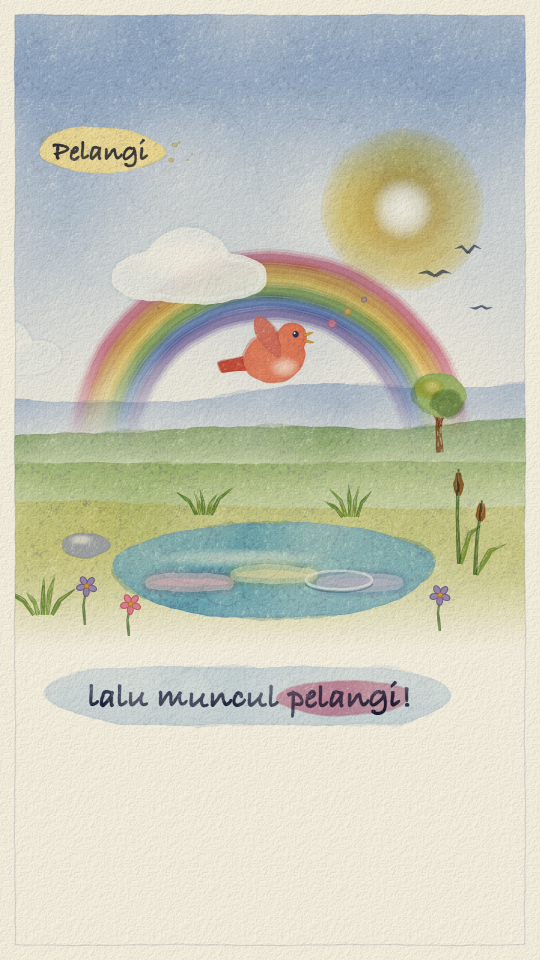

# Watercolor

Pure wet-on-wet watercolour on cold-press paper. There is no drawing under the paint and no line round anything: a shape is a translucent wash with a slightly ragged tide edge, darker pigment pooled along its rim, blotchy pigment inside, a backrun or two where water crept back in, granulation in the tooth of the paper, and the white of the paper left as its highlight. Washes are multiplied onto the sheet, so where two overlap they mix like glazes. Thin things (grass, branches, legs, rain) are loose tapered brush strokes with dry-brush streaks. The sheet is warm white with a visible tooth and the clean margin that masking tape leaves. Lettering is soft brush-pen writing painted like a wash; captions sit on a pale wash strip. Motion on 2s, slow and calm.

Pick it for nature, weather, seasons, feelings, bedtime and reflective pieces, gentle children's and Islamic educational content — anything that should feel quiet, hand-painted and airy. Not for data, UI, diagrams or anything that needs crisp edges, small labels or dense frames. The nearest shipped style is `storybook`, which also uses washes but draws a coloured-pencil outline round everything and has a cute round hero; here form comes only from layered glazes.

**The one rule: form comes from glazes, never from lines.** Every shape is a wash; a darker shape is a second wash on top; a highlight is paper that was left or lifted. Paint never slides or pops: it blooms in (a wet spot spreads with a pale feathered edge leading, then the pigment settles and the rim darkens) and it leaves by being lifted with clean water.

## Palette and meaning (`WCL` in kit.js)

A limited landscape set. Hexes are the pigment at full strength; on paper a wash at the default strength (0.8, multiplied) is lighter.

| role | hex | use |
|---|---|---|
| paper | `paper #f6f1e4` | the sheet, the morph ground, every highlight, the taped margin |
| shadow / distance | `indigo #3f4c7c` | far hills, cloud bellies, rain, far birds |
| clear sky | `ultra #5a86cc`, `sky #9fc3e6` | the sky wash after the rain; pale sky: the caption strip, fair-cloud shadows |
| rain | `storm #8590ad` | rain clouds, a grey sky, stones |
| water | `water #6f95bd`, `lake #4c9ec6` | a puddle under a grey sky ("before"), a lake under a clear one ("after") |
| growth | `sap #86ad4c`, `olive #5c8048` | grass, near hills, leaves; olive is their shadow glaze |
| earth | `sienna #b3693d`, `ochre #dfa643` | branches, legs, reed heads; ground, beaks, tags |
| light | `lemon #f2d35c` | sunlight, the sunny touch on a crown or the ground |
| accent | `rose #de7391`, `violet #8c7abc` | flowers, the dab under the highlighted word, rainbow ends |
| **hero** | `hero #e0562f` | vermilion: Pipit the bird. Reserved for the hero. |
| ink | `ink #2c3158` | lettering and the dot eye (never black) |

A frame uses one sky, two greens, one earth colour, the hero's vermilion and at most one accent. A rim or shadow is the same pigment laid thicker (`wclDeep`), never black or grey. Morph between neighbouring pigments (water → lake, sap → olive, ochre → sienna): the blend is a believable mixed puddle.

## Wash, texture and type

- **A wash** (`wclWash`): built at full strength on a small scratch canvas, then multiplied onto the frame at `al` (0.8). The outline gets a ragged edge seeded by its key (slow swells + a fine tremble, 3 px; it does not boil — paint stays put on paper). A crisp wash has a paler tide fringe just outside it and a pooled rim inside: two soft bands (22 and 10 px) and a broken 3.4 px line in the deeper tone. A soft (wet-in-wet) wash is feathered by `soft` px and has almost no rim. Inside: blotches that travel with the shape (a seeded 512 px tile erased from the wash), granulation (the high spots of the paper erased, sediment added in the low spots), 0–3 backruns by area (a paler centre and a ragged pigment ring), and any `keep` spots of bare paper. `grade` runs a wash out to clear water (skies, hill mist, the ground fading into bare paper).
- **Paper:** one seeded 256 px height field makes three tiles (lit tooth, granulation mask, sediment), so pigment settles where the paper is low. `STYLE.post` multiplies the tooth over the whole frame and lays a 30 px clean taped margin with a faint pooled line along it.
- **Glazing:** washes are translucent. To stop what is behind showing through (the hero, a lake on a green field, the caption strip) reserve paper first with `mask` — the painter's masking fluid.
- **Brush strokes** (`wclBrush`): a tapered ribbon with pigment pooled along one side and up to three paper-coloured dry-brush streaks. **Dabs** (`wclDab`) and **small shapes** (`wclPoly`) are single touches with their own rim. **Splatter** (`wclSplatter`): a few flicked drops beside tags, clouds and the morph.
- **Static parts** (sky, hills, ground, trees) are painted once into a cached sheet with `wclLayer`; only moving things are painted per frame.
- **Type:** `WCL_FONT` = `"Bradley Hand", "Segoe Print", "Ink Free", "Comic Neue", "Comic Sans MS", "Chalkboard SE", "DejaVu Sans", cursive`, weight 700 plus a hair of stroke. Each letter sits a hair off the line, the pigment lies unevenly inside the strokes and pools at their feet. Captions 68 px, tags 56 px, in `ink`.

## Motion habits

- On 2s (`ones: false`). Edges and granulation are static; only the hero's edge boils (`boil: true`), like a figure repainted for every drawing.
- **Bloom in:** `bloom: wclBloom(t0, d)` — the wash spreads from a point (10% → 100% in the first 70%, eased out) while pale and feathered, then settles: strength 60% → 100%, the rim and granulation arrive last. 0.6–0.9 s per wash, started on the beat; a second glaze (a cloud's belly, a tree's shadow) follows a third of the way in.
- **Leave by lifting:** `lift: 0..1` — soft spots of clean water open in the wash as it fades. Captions and tags are lifted over the first 0.25 s of a bridge and painted back after it.
- **Slow drift only:** clouds 6–30 px/s, a blown leaf, far birds as two brush strokes flapping on the boil, grass and reeds leaning a few degrees, rings spreading on water (`wclRipple`), rain as short slanted strokes.
- **Impacts are small:** a drop lands with a ring and five flicked droplets; the puddle spreads on a smooth spring. No shake, no squash and stretch.
- **The hero** shivers one pixel-step while it rains, lifts its head, takes off with wings beating on the boil, hovers on a slow bob, opens its beak to sing (three dabs float off).
- **Camera:** a ≤ 5% push inside an era; after a morph the new era opens ~10% close on the object and settles.
- **Morph:** the era is seen through a patch that is still wet — its edge fades into clean water with the bridge colour pooled along it — closing onto the object; on bare paper the puddle is re-wetted (its edge feathers and the rim lets go at the midpoint, the pigment running from one colour to the other, a few drops flicked round it); the new era opens out of it the same way.

## Frame checklist (on top of grammar/FRAME.md)

1. **No outlines.** Nothing is stroked round its edge in ink or pencil. The only "lines" are the pooled rim inside a wash, brush strokes for thin things, and lights lifted out with a damp brush (leaf veins, ripple rings).
2. **The medium shows at phone size:** soft cloud edges, a visible rim on the big crisp washes (a lake, a leaf), a graded sky, paint running out into bare paper, the taped margin.
3. **White is paper.** Highlights, the sun's disc, fair clouds and the ground under the caption are unpainted or masked paper — never white paint. At least a quarter of the sheet is bare or nearly bare.
4. **Glazes mix on purpose.** Where two washes overlap the result is a believable mix (blue over green is fine; three colours over each other is mud). Anything that must keep its own colour has `mask`.
5. **Vermilion belongs to the hero.** No vermilion flowers, fruit or suns; rose and violet are the accents.
6. **The painting stops above the caption.** The ground wash runs out into bare paper by y ≈ 1300; the caption strip (y ≈ 1330–1455) is masked and nothing is painted in its band.
7. **Something is arriving or drifting:** a wash blooming, rain falling, a ring spreading, a cloud leaving — plus two or three slow idle details.
8. **Bridge objects are puddle-like washes of similar proportions** (an oval into a wider oval), clear of everything else at the bridge time.

## Kit API (`kit.js`, on top of `kit/core.js`)

- Palette and font: `WCL`, `WCL_FONT`, `WCL_TAPE` (margin width).
- Colour (hex or `rgb()`): `wclRGB(c)`, `wclA(c, alpha)`, `wclMix(a, b, u)`, `wclDeep(c, k)` (the same pigment laid thicker).
- Caches: `wclMemo(key, w, h, fn)`, `wclTiles()`, `wclPat(name)` (`'tooth' | 'gran' | 'sed' | 'blotch'`), `wclLayer(key, fn, { ground, al })` (a static part painted once; `ground: true` = the scene's first coat, laid opaque).
- Scratch (for custom washes): `wclBegin(x0, y0, x1, y1)` → `{ g, cv, T, x, y, w, h, z }` or null, `wclPatFill(R, name, al, mode, matrix)`, `wclEnd(R, al, mode)`.
- Geometry: `wclCentroid(P)`, `wclEdge(P, closed, amt, key, boil, step)`, `wclTrace(g, P, closed)`, `wclBlobPts(x, y, rx, ry, { key, lump, n, rot })`, `wclUnionPts([[x, y, rx, ry, rot?], …], n)`, `wclHillPts(x0, x1, y, amp, key, base)`, `wclCloudPts(x, y, w)`, `wclBirdShape(r, headDrop)`, `wclHeroPts(x, y, r)`.
- Timing: `wclBloom(t0, d)` (0..1 from time t0 over d seconds), `wclBridgeK()` (captions' strength through a bridge).
- The wash: `wclWash(P, c, { key, al, soft, rim, rimW, uneven, blotch, gran, blooms, keep: [[x, y, rx, ry, a]], grade: [x0, y0, x1, y1, a], bloom, from: [x, y], wet, wetSoft, lift, mask, amt, raw, boil, deep })`.
- Small marks: `wclDab(x, y, rx, ry, c, { rot, al, deep, mask })`, `wclPoly(P, c, { al, mask, w })`, `wclBrush(P, w, c, { key, al, taper: [start, end], dry, frac })`, `wclSplatter(x, y, r, n, c, key, { al, s })`, `wclLight(x, y, rx, ry, al)` (lift a light).
- Set: `wclSky(c, hz, { key, al, from, to, uneven, blooms })`, `wclHills(y, base, c, { key, al, amp, x0, x1, rim, blooms, to })`, `wclGround(y, base, c, { key, al, amp, blooms })`.
- Props: `wclCloud(x, y, w, c, { key, bloom, lift, al, belly, fair })`, `wclRain(x0, y0, x1, y1, n, { key, c, al, slant, speed, len })`, `wclRipple(x, y, rx, age, { dur, sq, c })`, `wclSplash(x, y, age, c, { key, n, power })`, `wclGrass(x, y, s, c, key, n)`, `wclReed(x, y, h, key, { lean, c })`, `wclTree(x, base, h, { key, r, c, bloom })`, `wclBigLeaf(x, y, lx, ly, r, { key, rot, c, mask })`, `wclLeaf(x, y, rot, s, c)`, `wclFarBird(x, y, s, flap, c, key)`, `wclFlower(x, y, h, c, key, s)`, `wclStone(x, y, rx, ry, key, c)`, `wclSun(x, y, r, { key, bloom })`, `wclRainbow(cx, cy, r, bw, { key, cols, grow, al, fadeY })`.
- Hero: `wclBird(x, y, r, { key, dir, mood: 'smile' | 'sad' | 'happy' | 'wow', fly, wing, lift, rot, sx, sy, boil, c, al, noBlink })` — Pipit; (x, y) the body centre, r the body radius (the bird is ~2.9 r long); perched it stands on y + 1.25 r; sets `SPARK_AT`.
- Type: `wclFont(g, size)`, `wclTextW(str, size)`, `wclText(str, x, y, size, c, { align, key, reveal, al })`.
- Captions (through `DEFER`): `wclCaption('words *highlight* words', { y, x, size, at, c, hi, col })`, `wclTag('Label', { x, y, size, at, c, col })`.
- `STYLE`: `paper`, `backdrop` (the sheet under a thin uneven wash), `window` (a wet-edged patch with the bridge colour pooled along it), `blob` (the re-wetted puddle), `hero`, `heroColor`, `heroPts`, `post` (taped margin + paper tooth), `ones: false`.

## Do / don't

- **Do** paint light to dark: the sky and ground first (in a `wclLayer`), then glazes, then the small dark touches.
- **Do** leave paper: `keep` a highlight in every big wash, let the ground run out, use `mask` under whatever must stay clean.
- **Do** give every wash a stable `key`: its edge, blotches and backruns are seeded by it and must not reshuffle.
- **Do** start blooms on the beat and let them take their time (≥ 0.6 s).
- **Don't** stroke outlines, add drop shadows, or use white or black paint.
- **Don't** stack more than two or three strong washes in one place, or put complementary colours over each other (rose over sap goes brown).
- **Don't** put anything that depends on `TT` or `B` inside a `wclLayer`, and don't expect a `mask` inside a layer to lift what is under the layer.
- **Don't** pop, bounce or slide things; don't boil the edges of anything but the hero.
- **Don't** set long or small text: one line of ≤ ~22 characters; the hand face thins out below ~48 px.
- **Don't** use filters, `shadowBlur` or per-pixel loops per frame: softness is a stack of five strokes, texture is tiles.

## Not matched / known weaknesses

- Built from the medium's conventions, not measured against a specific painting or film.
- There is no pigment simulation: a bloom is a scaled, feathered shape, not a diffusion; backruns are placed by seed, not where wet actually met wet; overlaps are a plain multiply.
- The pooled rim has the same strength all round (real pigment pools on the low side), and it is subtle on small or pale washes.
- A wash is one flat colour; a colour change inside one shape (a sunset sky) needs two graded washes over each other.
- Multiply glazing gets muddy fast, so everything that sits on a wash of another hue reserves paper first: `wclTree`, `wclStone` and `wclFlower` mask by default (`mask` in their options turns it down), and the demo paints the tree after the rainbow and lifts the lake's reflections before tinting them. A plain `wclWash` / `wclDab` laid over a different hue without `mask` will still go grey.
- Soft washes are the costly part (five wide strokes each): a frame with three soft clouds, a leaf, the hero and the captions is about 2–3× a frame of flat fills.
- Lettering is a system hand face (Bradley Hand on macOS; Segoe Print / Ink Free / Comic Neue elsewhere look different) and is not real brush lettering; captions are single-line only.
- The paper tooth is fine and screen-fixed: it does not move with the camera, and it softens under video compression.
- The demo does not loop seamlessly.

## Proven on

Its demo only. `demo/` (6s, 9:16, 120 BPM, 24fps): under a storm-grey sky three rain clouds bloom in over indigo and olive hills, rain falls, three big drops land in a puddle that spreads with each one (rings and flicked droplets), and Pipit shelters hunched under a taro leaf, then looks up as the rain stops; clouds drift, grass leans, a leaf blows across, the leaf drips — tag "Hujan", caption "Rintik *hujan* turun". At 3.0s the puddle is re-wetted and runs into a lake under a clear sky: the sun blooms, a rainbow is pulled across band by band, Pipit flies up under it and sings; fair clouds leave, far birds glide, rings spread on the lake, reeds lean, flowers open — tag "Pelangi", caption "lalu muncul *pelangi*!". Tile deterministic; on an idle machine ~30–55 ms/frame (9–16 ms inside the morph; the first frame of each era ~90–120 ms while its layer and the tiles are made); review: morph on grid, flat frames none, text PASS, story arc PASS, dead beats PASS, -14.6 LUFS, true peak -3.4 dBFS.
