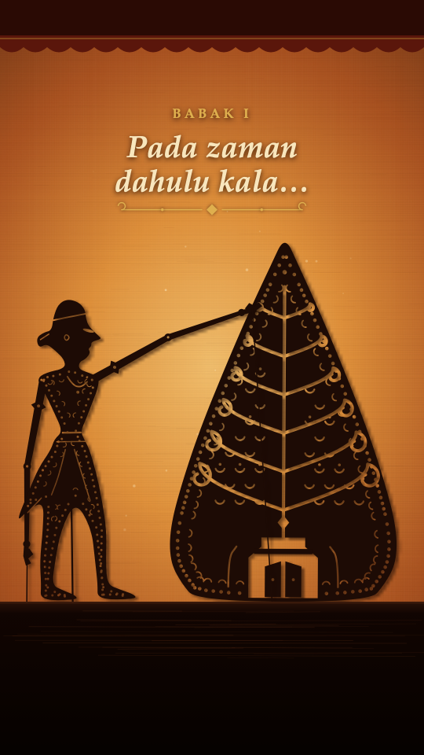

# Wayang

Indonesian shadow-puppet theatre (wayang kulit) as the audience sees it on the **kelir**, the screen: a warm cloth lit from behind by an oil lamp (blencong) that flickers, glowing amber in the middle and falling off to deep brown-red at the edges. Every figure is a **flat dark silhouette** pressed to the cloth — a crisp shape with a soft shadow copy behind it — **perforated** with tatahan (rows of dots along the edge, crescent "scales" inside, ornament lines) so the lamp shows through. Puppets are in profile, arms jointed at shoulder and elbow and moved by thin rods (tuding) that run down into the banana-trunk stage (gedebog), a dark band along the bottom. The **gunungan / kayon** — the tall pointed leaf with a tree of life cut through it — is the transition object. Lettering is an elegant italic serif in cream with a gold ornamental rule. Motion on 2s.

**The one rule: figures are dark shapes with light coming *through* them.** Never draw lines or colour *on* a figure; every detail is a cut-out in the lamp's colour (or a shape added to the silhouette).

## Palette and meaning (`WY` in kit.js)

| role | hex | use |
|---|---|---|
| screen, lamp centre | `glow #ffd27e` | the brightest point of the kelir (lamp at x 540, y 930) |
| screen | `mid #e8963c` → `ember #a2441a` → `edge #2e0c05` | the radial falloff (stops 0.3 / 0.62 / 1.0 of an 1150px radius, a touch squashed vertically) |
| era ground / paper | `amber #d08a3c`, `dusk #c0703a` | the tint mixed 22% into the falloff; `paper` = amber (the morph sheet) |
| silhouette | `ink #1e0c06` | puppets, the gunungan, rods — anything pressed to the screen |
| shadow copy | (the figure itself) | a softened copy of the whole figure, offset (7, 5) at 55%; `inkS #2c140a` is kept in the palette but no longer drawn |
| far scenery | `far #6b3015` | mountains and anything further from the screen (`depth`): lighter and blurrier |
| type | `cream #fbe9c0`, `gold #e2b24f`, `goldD #a8742a` | captions; the tag and ornamental rule; the border's line |
| furniture | `red #5c170c`, `stage #120603`, `stageL #3a1a0c` | the top border (plisir); the gedebog band and its top edge |

Cut-outs are **real holes**: every figure is drawn on a scratch layer (`wyFigure`) and its tatahan and ornament lines are punched out with `destination-out`, so what shows through is the lit screen itself, or whatever stands behind (a hole in the puppet in front of a mountain shows the mountain's shadow, as on a real kelir). `wyLightAt(x, y)` (the screen's colour at a point, lifted 18% toward white) is only the fallback for a `wyCut` made outside any figure.

## Silhouette and perforation

- **Figure:** `wyFigure(fn, { soft, depth })` — everything `fn` draws (`wySil`, `wyCut`, `wyCutDot`, `wyRod`) is one piece of leather: one layer, one soft shadow, real holes. `wySil(P, o)` called on its own is a figure of one shape. The soft shadow is the layer halved down to 1/4, 1/8 or 1/16 and enlarged again (no `ctx.filter`); `depth` widens it. Outlines go through `trace` (smoothed); `sharp: true` keeps straight edges (houses, gates, doors, arms).
- **Tatahan** (`wyHoles`, cached by `key`): a row of dots 13·scale px inside the edge every 19·scale px; a row of small crescents 30·scale px in, facing outward; inside, crescent "scales" opening down on a staggered grid (`step`, default 30), at least 50·scale px from the edge, a dot above every third row. `skip(x, y)` keeps the inner scales out of an area (the gunungan's trunk); `clear(x, y)` keeps every cut-out out of it (a puppet's head).
- **Ornament lines** are cut, not drawn: `wyCut(P, w)` (belts, kain folds, the tree of life, a headcloth band), `wyCutDot(x, y, r, ry, rot)` (eyes, studs, pins).
- **Depth:** scenery behind the puppets gets `depth` 0.25–1 (lighter `far` tone, a wider shadow, holes about two-thirds open) so a puppet walking past a tree still reads.
- **Rods:** `wyRod` — a 3–7px dark line from the hand (or the body's centre) down into the stage; inside a figure it shares the figure's shadow.
- **The puppet's canon** (what makes it wayang kulit and not a generic silhouette): a small head with a long nose and a narrow eye, a long neck, broad shoulders turned to the viewer over a narrow waist, a wide stance with both feet pointing the way it faces, a tail of cloth behind, thin arms long enough to reach the knees with an armlet, a bracelet and a curled hand. The hero wears a plain knotted headcloth — no crown and no court hair-curl — so it is nobody from the epics or the punakawan.
- Sizes at 1080×1920: puppet 740px tall, gunungan 900px, stage line y 1530.

## Motion habits

- On 2s (`ones: false`) — a hand-held puppet, not a vector animation.
- **Puppets walk by bobbing**: |sin| hops (≈ 4% of the height) with a ±2° rock and arms swinging from the shoulder; standing, they breathe (a slow 1% bob); `stop` adds a small rock that dies away after the last step. Arms pivot **stiffly** at shoulder and elbow (`reach` lifts the front arm to present or point; `wave`).
- **The gunungan spins about its rod** (`turn` = cos of the angle: it thins to an edge and opens again), then steps aside on a heavy spring with a decaying tilt sway.
- Scenery rises out of the stage (as a dalang plants it in the gedebog), trees sway ±2°, birds flap.
- The lamp flickers on 2s (`wyFlick`): the glow's radius ±2.5%, a 3–6% darkening pass over the frame. Dust motes drift up through the beam.
- Camera: almost still — a ≤ 4% push centred on the stage line, so feet never slide on the stage; after the morph it settles from 6% on a slow spring.
- Morph: the bridge shapes are pointed-top-on-flat-base (gunungan → mountain). The window is a hole cut in leather: a 40px dark rim around the outline, dotted.

## Frame checklist (on top of grammar/FRAME.md)

1. **The lamp is the light:** a bright centre around y 930, dark corners; the top of the frame dark enough for cream type.
2. **Every figure is one dark tone with cut-outs** — no fills in other colours, no strokes on top, no gradients on figures.
3. **Perforation reads as ornament, not noise:** an edge row of dots + one row of crescents + sparse scales; heads and small parts (arms, birds) stay solid.
4. **Everything stands on the stage line** (y 1530); rods disappear into the gedebog.
5. **Puppets in profile**, at most one puppet and one big object (gunungan, mountain) as the focus; scenery behind them at `depth`.
6. **Type sits at the top** (tag y 300, caption from y 400, 78px italic serif, ≤ 2 lines) with the gold rule under it; never over a silhouette.
7. **Something moves in every held frame:** flicker, motes, bob, sway, birds.

## Kit API (`kit.js`, on top of `kit/core.js`)

- Palette and colour: `WY`, `WY_SERIF`, `WY_STAGE` (the stage line, 1530 by default; the kit owns it — a piece moves it with `wySetStage(y)` at the top of its scenes file), `WY_LAMP`, `wyMix(a, b, u)`, `wyRGB`, `wyLightAt(x, y, tint)`, `wyFlick()`.
- Screen: `wyScreen(tint)` / `wyScreenFill(c)` (lamp glow painted at quarter size and enlarged + cached cloth weave), `wyMotes(n, key)`, `wyScratch(name, w, h)` (a named scratch canvas).
- Geometry: `wyInside(P, x, y)`, `wyEdgeD(P, x, y)`, `wyChaikin(P, n)`, `wyCentroid`, `wyTrace(P, closed, sharp)`, `wyZoom()`.
- Figures and silhouettes: `wyFigure(fn, { soft, depth })`, `wyGrow(P)` (tell the open figure how far a custom drawing reaches; a figure that reports nothing takes the whole frame), `wySil(P, { key, col, soft, depth, holes, rows, interior, step, scale, skip, clear, light, sharp })` (`soft` counts only when it is called on its own), `wyHoles`, `wyDrawHoles(holes, col, a)` (`col` null = punch), `wyCut(P, w, { fill, sharp, closed, a, light })` (`light` paints a colour instead of cutting), `wyCutDot(x, y, r, ry, rot)`, `wyRod(x0, y0, x1, y1, w)`.
- Gunungan: `wyGunungan(x, y, h, { turn, tilt, rod })` (x, y = base centre) + `wyGununganPts(x, y, h, { turn, tilt })` (bridge outline).
- Hero: `wyPuppet(x, y, s, { key, face, walk, stop, reach, wave, pop })` — an original young villager in profile (knotted headcloth, long nose, narrow eye that blinks, necklace, sash, kain with a tail), jointed rod arms (`wyArm`); sets `SPARK_AT`. `wyPuppetPts(x, y, s, face)` (bridge outline).
- Scenery: `wyMountain(x, y, w, h, { key, depth })` + `wyMountainPts`, `wyTree(x, y, h, { key, depth, tilt })`, `wyHouse(x, y, w, { depth, lit })` (a joglo; `lit`, default true, paints its door, windows and ornament in the screen's bright colour so it glows in front of dark scenery; `lit: false` cuts real holes), `wyBird(x, y, s, phase)`.
- Type (through `DEFER`): `wyTag('BABAK I', { y })`, `wyCaption('line one\nline two', { y, size, at })` (wipe-on per line, ornament under it, fades out in the first 0.3s of a bridge), `wyOrnament(x, y, half, frac)`, `wyTextLine`.
- Furniture: `wyStage()` (gedebog band and top border from a cached canvas, `wyFurniture()`; then the flicker pass) — called by `STYLE.post`.
- `STYLE`: `paper` amber, `backdrop` (the lit screen tinted by c), `window` (scene through a dotted leather rim), `blob` (a perforated silhouette in the bridge colour), `hero` / `heroPts` (`wyPuppet`), `heroColor` ink, `post` (`wyStage`), `ones: false`.

## Do / don't

- **Do** make the gunungan open and close acts: spin it, step it aside, morph it into the next world.
- **Do** keep puppets in profile with long arms and visible rods; that is what makes it wayang and not generic silhouettes.
- **Do** push scenery back with `depth` before adding more of it.
- **Don't** draw any known character (Semar, Petruk, Gareng, Bagong, Arjuna…) or a sacred figure; make original villagers, animals, places.
- **Don't** colour a figure or outline it; don't add highlights.
- **Don't** perforate small parts (they turn to noise) or put type over a silhouette.
- **Don't** move the camera much — the screen is fixed; the puppets move.

## Not matched / known weaknesses

- Built from the tradition's conventions, not measured from a reference performance.
- Real holes are honest but cost contrast: a puppet standing in front of dark scenery shows that scenery through its tatahan, so its ornament dims there. Keep scenery light (`depth` ≥ 0.8) behind a puppet, or stand the puppet against the open screen.
- Holes are cut through everything drawn earlier in the same figure (a rod behind a perforated body vanishes inside the holes); parts drawn later cover them. Order the parts back to front.
- The soft shadow is a bilinear enlargement, not a Gaussian: fine at 55%, slightly boxy if `soft` is pushed past ~20.
- Scratch canvases must stay large (the 1/4-frame size): Chromium takes small canvases off the GPU and every copy becomes a read-back (this is what made an earlier version slow).
- Text still uses `shadowBlur` (three short strings a frame; cheap). The coloured front-side (sungging) variant is not built.
- Speed: about 15–50 ms/frame in the tile on a busy machine (was 145–370), export ~35–55 ms/frame; the first frame is dearer (hole caches).
- The house is the one exception to real holes: its openings are painted lit-screen colour (a lamp inside), because cut through they opened onto the mountain and read dim.
- The hero is a slender *alus*-type figure only; there is no second body type (stout, old, child) and no mouth movement.

## Proven on

`demo/` (6s, 9:16, 120 BPM, 24fps): on the lamp-lit screen the gunungan spins on its rod and steps aside while a villager puppet walks in and lifts an arm to present it ("Pada zaman dahulu kala…"); at 3.0s the gunungan becomes a mountain — trees and a joglo house rise from the stage, birds cross, the puppet walks in and waves ("di sebuah desa di kaki gunung"). Gamelan-like score in a slendro-like scale (saron balungan, bonang, kenong, a kendang pattern of dung and tak with a roll into the morph, kecrek, a beating-pair gong on the first beat and on the morph; nothing tuned to the piano). Tile deterministic; review: morph on grid, text PASS, story arc PASS, dead beats PASS, -16.0 LUFS, true peak -1.0 dBFS.
